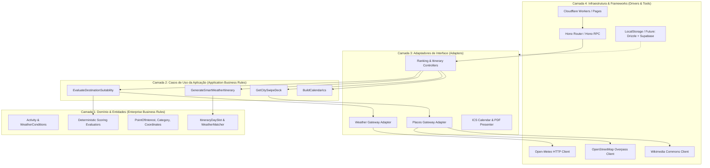
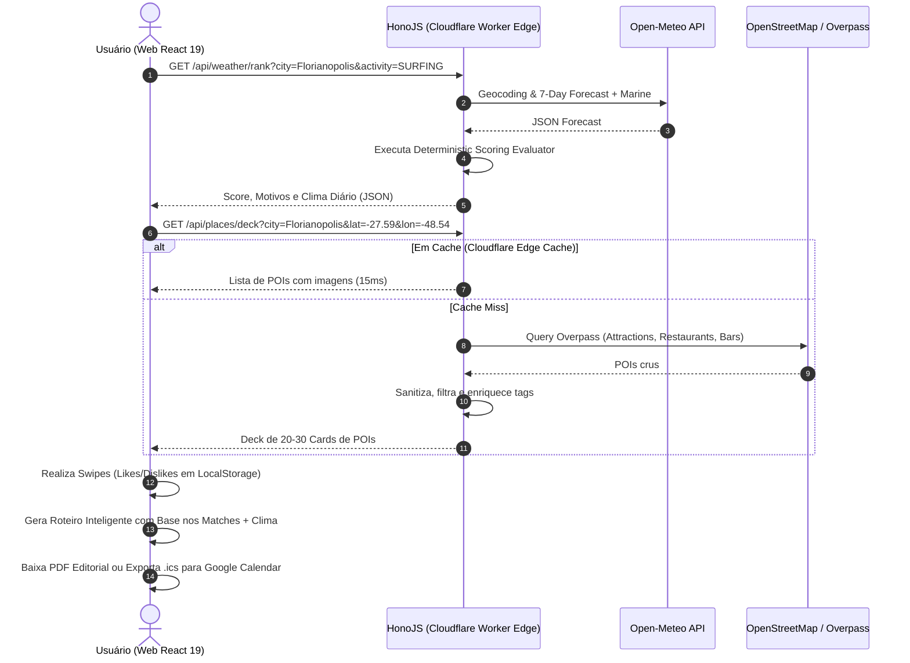
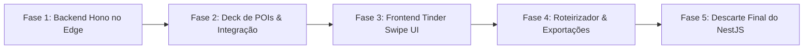

# Windrose App — Relatório de Viabilidade, Arquitetura & Implementação
## Migração para HonoJS no Cloudflare Workers, Descarte do BFF NestJS e Roteirização Climática Estilo "Tinder Swipe"

---

## 1. Sumário Executivo & Diagnóstico Atual

O **Windrose App** foi concebido como uma aplicação para avaliação de destinos turísticos por viabilidade climática em uma janela de 7 dias através da API do Open-Meteo. A implementação atual opera sob um monorepo NX com:
- **Frontend**: React 19 + Apollo Client + Dark Glassmorphic UI (`apps/web`).
- **Backend (BFF)**: NestJS + GraphQL Code-First + Apollo Server hospedado no container do Render (`apps/api`).
- **Domínio**: Avaliadores determinísticos de atividades (`Outdoor Sightseeing` e `Surfing`).

### O Problema do Modelo Atual
1. **Infraestrutura e Custo**: O NestJS em container (Render Free Tier) sofre com cold starts lentos (~50 segundos após inatividade), limites de memória (512 MB) e risco de descontinuação ou sleep periódicos.
2. **Sobrecarga Arquitetural (Overhead)**: Para um backend que orquestra chamadas HTTP (Open-Meteo, geocodificação e POIs), o ecossistema NestJS + GraphQL acarreta um bundle pesado, complexidade de decorators e boilerplate desnecessário.
3. **Bundle Frontend**: O `@apollo/client` adiciona mais de 45 KB (gzipped) ao frontend apenas para consumir duas queries.

### A Nova Visão
- **Backend Edge com HonoJS no Cloudflare Workers**: Custo $0 (Free Tier vitalício), latência sub-10ms globalmente, sem cold starts perceptíveis.
- **Transição de API**: Adoção de **Hono RPC** ou REST com validação Zod, permitindo tipagem ponta-a-ponta compartilhada (Zero GraphQL schema overhead, remoção completa do Apollo Client).
- **Descoberta Gamificada (Tinder-style Swipe)**: Swipe deck interativo para curtir/rejeitar atrações, restaurantes e bares.
- **Roteirizador Climático Contextual**: Cruzamento dos itens curtidos com a previsão do tempo de cada dia (atividades outdoor nos dias ensolarados; indoor, bares e museus nos dias chuvosos ou de ventania).
- **Stateless Inicial & Exportação de Alto Valor**: Sem necessidade de banco de dados na fase 1; geração de PDF customizado e arquivos de calendário `.ics` (compatíveis com Google Calendar, Apple e Outlook).
- **Prontidão para Futuro**: Arquitetura limpa preparada para receber Drizzle ORM + PostgreSQL (Supabase) via inversão de dependência.

---

## 2. Análise de Viabilidade Técnica e Financeira (100% Free Tier)

| Componente | Solução Anterior | Nova Solução (Proposta) | Custo Mensal | Limites Free Tier | Viabilidade |
| :--- | :--- | :--- | :--- | :--- | :--- |
| **Computação Backend** | NestJS no Render Free Web Service | **HonoJS no Cloudflare Workers** | **$0.00** | 100.000 requisições/dia, 10ms CPU/req, cold start < 5ms | **Altíssima (100% viável)** |
| **Hospedagem Frontend** | Vercel Hobby | **Cloudflare Pages** ou Vercel Hobby | **$0.00** | Unlimited bandwidth / builds gratuitos | **Altíssima** |
| **API Meteorológica** | Open-Meteo | **Open-Meteo API** (mantido) | **$0.00** | Gratuito para uso não comercial (até 10.000 chamadas/dia) | **Excelente** |
| **Dados de POIs (Atrações)**| N/A | **OpenStreetMap (Overpass) + Wikimedia / Wikivoyage API** | **$0.00** | 100% aberto e gratuito; enriquecido via Cloudflare Cache API | **Alta** |
| **Armazenamento / BD** | N/A | **Client-Side Storage (LocalStorage + URL State / Hash)** | **$0.00** | Sem custos de infraestrutura de persistência na Fase 1 | **100% viável** |
| **Banco Futuro (Fase 2)** | N/A | **Supabase Free Tier + Drizzle ORM** | **$0.00** | 500 MB DB, conexões pooling via Hyperdrive / Direct | **Pronto para expansão** |

> [!TIP]
> A combinação **Hono + Cloudflare Workers + Cloudflare Cache API** permite cachear resultados da Overpass API e Open-Meteo na borda com TTL de 12 a 24 horas por coordenada/cidade, garantindo que o limite de 100k requisições diárias suporte dezenas de milhares de usuários simultâneos com custo zero.

---

## 3. Engenharia de Software: Clean Architecture no Edge

Em conformidade com os princípios de **Clean Architecture** (Robert C. Martin), as regras de negócio de pontuação de clima e roteirização devem permanecer independentes de frameworks web (Hono, NestJS), de provedores de nuvem (Cloudflare, AWS) e de mecanismos de persistência (Drizzle, localStorage).



### Regras de Dependência e Portas (Ports & Adapters)
1. **Entidades de Domínio**:
   - `WeatherEvaluator`: funções puras que recebem variáveis meteorológicas (temperatura, precipitação, vento, UV, ondas) e geram a nota determinística (0-100) e os motivos (`reasons`).
   - `WeatherItineraryMatcher`: lógica que aloca atrações do tipo `OUTDOOR` nos dias com `recommendationLevel` = `EXCELLENT`/`GOOD`, e atrações do tipo `INDOOR`/`FOOD_DRINK` nos dias chuvosos ou de clima severo.
2. **Ports (Interfaces na camada de Domínio/Aplicação)**:
   - `WeatherPort`: `getForecast(lat, lon): Promise<WeatherForecast>`
   - `GeocodingPort`: `resolveCity(name): Promise<LocationCoordinates>`
   - `PlacesPort`: `getPlacesByCategory(lat, lon, categories): Promise<PointOfInterest[]>`
3. **Adapters (Humble Objects)**:
   - Os controladores Hono apenas recebem a requisição validada pelo Zod, invocam o caso de uso e retornam JSON puro.
   - O Hono RPC fornece os tipos TypeScript diretamente ao frontend sem compilação de schemas GraphQL intermediários.

---

## 4. Benchmark de Mercado, Gaps Competitivos & Oportunidades

Analisando os principais players do nicho de planejamento de viagens e ferramentas climáticas:

| Player / Ferramenta | Proposta Principal | Pontos Fortes | Gaps Críticos Identificados | Oportunidade para o Windrose |
| :--- | :--- | :--- | :--- | :--- |
| **Wanderlog** | Planejador de roteiros colaborativo e mapas | Rica base de dados, rotas otimizadas | **Ignora o clima em tempo real** ao agendar atividades diárias; interface pesada e burocrática em desktop; exportação avançada é paga | **Clima-responsivo nativo**: Windrose realoca atividades automaticamente se a previsão mudar |
| **TripIt** | Agregador de reservas e voos | Automação por e-mail | Focado em logística de voo/hotel, não em descoberta ou roteirização de lazer | Foco no viajante de experiência e lazer espontâneo |
| **PackPoint** | Gerador de malas baseado em previsão do tempo | Excelente uso do clima para preparar itens | Restrito apenas à mala; não monta itinerários nem lista atrações | Windrose unifica a viabilidade da atividade com as atrações reais da cidade |
| **Curiosio** | Planejador de road trips geográfico | Cálculo de rotas e orçamentos | Interface antiquada, sem apelo visual ou gamificação | Abordagem visual moderna, mobile-first e interativa |
| **Tinder-style Travel Apps** (Swipe Guide / NomadSwipe) | Descoberta por swipe de destinos | Alta retenção e gamificação rápida | Paravam no swipe sem transformar as escolhas em um roteiro prático e cronológico | **A tríade do Windrose: Swipe -> Match -> Roteiro Inteligente com Clima** |

### O Grande Diferencial Competitivo do Windrose
A maioria dos viajantes comete o erro clássico de planejar visitas a mirantes, praias ou trilhas em dias que amanhecem chuvosos, e visitar museus em dias de sol radiante.
O Windrose inova ao **cruzar as preferências do usuário (matches do Swipe) com a curva meteorológica de 7 dias**, criando um roteiro adaptativo.

---

## 5. Arquitetura da Feature "Tinder-style Swipe Deck" & Descoberta de POIs

### 5.1 Onde Obter Dados de Pontos Turísticos de Forma 100% Gratuita?
1. **OpenStreetMap / Overpass API (Primária)**:
   - Consulta tags OSM na cidade: `tourism=attraction`, `amenity=restaurant`, `amenity=bar`, `tourism=museum`, `leisure=park`, `historic=monument`.
   - Retorna coordenadas, nome, tipo de culinária/atração, e tags `indoor=yes|no`.
2. **Wikimedia Commons & Wikipedia API (Enriquecimento de Imagens e Descrições)**:
   - Para atrações turísticas principais, a API da Wikimedia retorna fotos de alta resolução licenciadas (Creative Commons) e resumos editoriais rápidos em múltiplos idiomas sem custo.
3. **Estratégia de Cache no Cloudflare Workers**:
   - As atrações de uma cidade não mudam diariamente. A rota `/api/places?city=...` usa o `caches.default` da Cloudflare com `Cache-Control: public, max-age=86400, s-maxage=604800` (7 dias). Requisições subsequentes para a mesma cidade respondem em ~15ms sem consultar a Overpass API.

### 5.2 Física e UX do Swipe Deck no Frontend
- **Biblioteca Recomendada**: `@use-gesture/react` combinada com `framer-motion` (ou CSS transform + physics leves baseadas em springs).
- **Ações**:
  - Drag à direita (> 120px ou velocidade > 0.5): **Match** (coração verde neon / glow).
  - Drag à esquerda (< -120px): **Rejeitar** (X vermelho/coral).
  - Drag para cima: **Supermatch / Prioridade Alta** (destaque especial no roteiro).
  - Botões inferiores acessíveis: ❌ Rejeitar, ⏪ Desfazer (Undo), ❤️ Curtir.
- **Acessibilidade (WCAG 2.2 AA)**:
  - Atalhos de teclado: Seta Esquerda (Passar), Seta Direita (Curtir), Espaço (Detalhes).
  - Suporte total a leitores de tela com `aria-live="polite"` anunciando o item atual e ação realizada.

```
+------------------------------------------------------+
|                     WINDROSE                         |
|   Florianópolis (24°C - Ensolarado pelos próx. 3 dias)|
+------------------------------------------------------+
|  +------------------------------------------------+  |
|  | [ IMAGEM DA ATRAÇÃO COM OVERLAY GRADIENTE ]    |  |
|  |                                                |  |
|  |  🌊 Praia da Joaquina                          |  |
|  |  Outdoor • Dunas & Surf • Nota Clima: 94/100   |  |
|  |  "Melhor dia para visita: Quinta-feira"        |  |
|  +------------------------------------------------+  |
|                                                      |
|       [ ❌ Passar ]    [ ⏪ Desfazer ]    [ ❤️ Curtir ]   |
|                                                      |
|   Deck: 12 / 20 lugares explorados                   |
|   [ Ver Roteiro Gerado (8 Matches) -> ]              |
+------------------------------------------------------+
```

---

## 6. Algoritmo de Geração do Roteiro e Estrutura de Sessão

### 6.1 Funcionamento Stateless (Sessão)
- **Persistência**: `localStorage` no browser estruturado sob a chave `windrose_trip_state`:
  ```typescript
  interface TripSessionState {
    city: string;
    coordinates: { lat: number; lon: number };
    travelDates: { start: string; end: string };
    weatherSummary: DailyWeatherScore[];
    swipes: {
      poiId: string;
      poi: PointOfInterest;
      status: 'liked' | 'rejected' | 'superliked';
      timestamp: number;
    }[];
    customNotes?: Record<string, string>;
  }
  ```
- **Compartilhamento sem Banco**:
  - Geração de link compartilhável via query string comprimida com `lz-string` no hash da URL (`#data=eJy1V...`). Qualquer pessoa que abrir o link tem o mesmo roteiro renderizado no cliente instantaneamente!

### 6.2 Otimizador Climático de Roteiro
O roteirizador organiza os itens com base em três slots diários:
- **Manhã (09:00 - 12:30)**: Atividades outdoor ativas (praia, trilha, parques).
- **Tarde (14:00 - 18:00)**: Atrações culturais, passeios urbanos ou compras.
- **Noite (19:30 - 22:30)**: Bares, restaurantes e gastronomia.

**Heurística de Adaptação**:
- Se um dia tem probabilidade de chuva > 60% ou nota outdoor < 40:
  - O algoritmo move as atrações `OUTDOOR` para os dias de pontuação alta.
  - Aloca museus, cafés, centros históricos cobertos e gastronomia no dia chuvoso.
  - Exibe um aviso visual amigável: *"💡 Otimizado para chuva: programamos o Museu e os Restaurantes para a Quarta-Feira chuvosa!"*.

---

## 7. Mecanismos de Exportação (PDF Customizado & Calendário)

### 7.1 Exportação para Agenda (.ics & Links Diretos)
1. **Geração de Arquivo `.ics` (RFC 5545)**:
   - Gerado 100% no cliente usando a biblioteca leve `ics` ou gerador de strings customizado sem dependências extras.
   - Cada atividade vira um evento com:
     - `SUMMARY`: Ex.: "🌊 Visita à Praia da Joaquina - Windrose Trip"
     - `DESCRIPTION`: Endereço, notas climáticas ("Previsão de 26°C e vento suave") e observações.
     - `LOCATION`: Coordenadas e endereço legível.
     - `DTSTART` / `DTEND`: Horários calculados pelo roteirizador.
2. **Deep Links de 1-Clique**:
   - Botão **"Adicionar ao Google Calendar"** via URL parametrizada:
     `https://calendar.google.com/calendar/render?action=TEMPLATE&text=...&dates=...&location=...`
   - Download de arquivo `.ics` para abertura direta no Apple Calendar / Outlook / Celular.

### 7.2 Exportação de PDF Customizado
- **Abordagem Recomendada**: Estilo tipográfico editorial com folha de estilo CSS `@media print` ultra-estilizada (ou `@react-pdf/renderer` para download programático de alta fidelidade).
- **Conteúdo do PDF**:
  - Capa estilizada com nome da cidade, coordenadas e resumo meteorológico da semana.
  - Grade visual dia a dia com ícones de clima, temperatura máxima/mínima e atividades alocadas.
  - Mini-mapa ou lista com endereços e horários recomendados.
  - QR Code para reabrir o roteiro digital no celular.

---

## 8. Arquitetura de Migração: Descarte do BFF NestJS para HonoJS



### Por que Hono RPC em vez de GraphQL?
- **GraphQL no NestJS**: Exigia compilar schemas, bibliotecas `@apollo/server`, `@nestjs/graphql`, `graphql`, `@apollo/client` no frontend, gerando complexidade e peso de bundle.
- **Hono RPC (`hono/client`)**:
  - O Hono permite exportar o tipo do router (`export type AppType = typeof routes`).
  - No frontend, importa-se o cliente Hono tipo-seguro: `const res = await client.api.places.deck.$get({ query: { city } });`.
  - Se um parâmetro de rota ou retorno mudar no backend, o TypeScript do frontend acusa erro em tempo de compilação sem precisar rodar geradores de código (`graphql-codegen`).

---

## 9. Preparação para o Futuro: Drizzle ORM + Supabase PostgreSQL

Mesmo operando sem banco na Fase 1, o código deve ser estruturado com interfaces para que a transição para banco de dados relacional seja uma simples adição de adapter:

```typescript
// libs/shared-types/src/lib/repository.interface.ts
export interface ITripRepository {
  saveItinerary(itinerary: UserItinerary): Promise<{ id: string; shareUrl: string }>;
  getItineraryById(id: string): Promise<UserItinerary | null>;
}

// Fase 1: LocalStorageTripRepository (implementado no client)
// Fase 2: DrizzleSupabaseTripRepository (implementado no Worker com Supabase Postgres)
```

No Cloudflare Workers com Hono, o **Drizzle ORM** conecta-se perfeitamente com o PostgreSQL do Supabase utilizando o driver `@neondatabase/serverless` ou `postgres` sobre WebSockets/Hyperdrive, mantendo cold start nulo e footprint de memória minúsculo.

---

## 10. Plano de Ação & Fases de Implementação



### Fase 1: Criação do App Hono na Edge (`apps/edge-api`)
- Inicializar projeto Hono configurado para Cloudflare Workers dentro do monorepo NX.
- Portar a lógica de geocodificação e os avaliadores de clima (`OutdoorSightseeingEvaluator` e `SurfingEvaluator`) para funções puras do domínio.
- Configurar endpoints Hono com tipagem Zod e Hono RPC.

### Fase 2: Módulo de POIs e Edge Caching
- Criar o client Overpass/Nominatim + Wikimedia para busca de atrações, restaurantes e bares.
- Configurar o Cloudflare Cache API para armazenar as listas de POIs por coordenada/cidade.

### Fase 3: Reformulação da Interface (UI/UX)
- Substituir Apollo Client por `@hono/client` + `TanStack Query` (React Query) no `apps/web`.
- Desenvolver o componente `SwipeDeck` com suporte a gestos de toque, física de mola e teclado.
- Atualizar a identidade visual para um Dark Theme com paleta neon/tropical elegante (turquesa para clima, coral para matches e âmbar para sol).

### Fase 4: Otimizador de Roteiro & Exportações
- Implementar o algoritmo de distribuição temporal (Manhã, Tarde, Noite) ponderado pelo clima diário.
- Desenvolver a geração de arquivos `.ics` e deep link para Google Calendar.
- Implementar o template de impressão/PDF editorial.

### Fase 5: Limpeza e Descarte do BFF NestJS
- Desativar e remover `apps/api` (NestJS) do monorepo e do Render.
- Limpar dependências antigas (`@nestjs/*`, `apollo-*`, `graphql`).
- Atualizar documentação e pipeline de deploy (Cloudflare Pages + Workers).
