# Windrose — Topologia de Agentes no Paperclip

Este documento descreve a arquitetura multi-agente do **Windrose** dentro da empresa **Leozizz Dev Labs** (`7cc4de9e-1eb0-44ea-8d5b-43d3d0d91655`) no **Paperclip**, com projeto dedicado **Windrose** (`7e340278-e6dd-4fcd-b1e5-578d569e1d12`), esteira SDD de 7 etapas e portão visual **Anti-Slop (`UX Reviewer`)** via Playwright MCP & CLI.

## Identificadores no Paperclip

| Recurso | Identificador |
| :--- | :--- |
| **Empresa** | `Leozizz Dev Labs` (`7cc4de9e-1eb0-44ea-8d5b-43d3d0d91655`) |
| **Projeto** | `Windrose` (`7e340278-e6dd-4fcd-b1e5-578d569e1d12`) |
| **Repositório GitHub** | `leozizz/windrose-app` |
| **Workspace Local** | `C:\Code\Leozizz\windrose-app` |
| **Modelo Padrão** | `gemini-3.8-flash-medium` |
| **Adapter** | `antigravity_local` (`instructionsBundleMode: external`) |

## Stack do Projeto

- **Frontend (`apps/web`)**: React 19 + Vite 8 + React Router 6 + Leaflet / React-Leaflet 5 + Lucide React + Design System **Windrose Wanderlust** (`#fbfbf9` / `#ffffff` / `#f97316`, tipografia `Plus Jakarta Sans` e `Inter`).
- **Backend Edge (`apps/edge-api`, `functions/api/`)**: Hono 4 + Zod + `@hono/zod-validator` rodando em Cloudflare Workers / Pages Functions (`/api/health`, `/api/weather`, `/api/places`).
- **Testes & Qualidade**: Vitest 4 + Testing Library + jsdom + ESLint + `agent-standards` (`pnpm standards:review`).

## Fluxo Autônomo de 7 Etapas (SDD + Anti-Slop UX Gate)

```mermaid
flowchart LR
    GH["GitHub Issue<br/>leozizz/windrose-app"] -->|pnpm sync:dispatch| PM["1. Windrose | PM<br/>specs/"]
    PM -->|handoff tech-lead| TL["2. Windrose | Tech Lead<br/>Arquitetura & Contratos"]
    TL -->|handoff backend| BE["3. Windrose | Backend<br/>apps/edge-api (Hono)"]
    TL -.->|sem API| FE["4. Windrose | Frontend<br/>apps/web (React 19 + Unslop)"]
    BE -->|handoff frontend| FE
    FE -->|handoff ux-reviewer| UX["5. Windrose | UX Reviewer<br/>Playwright MCP + Anti-Slop"]
    UX -->|reprovado| FE
    UX -->|aprovado: handoff qa| QA["6. Windrose | QA<br/>Vitest, WCAG, Build & standards:review"]
    QA -->|reprovado| BE
    QA -->|aprovado: handoff devops| OPS["7. Windrose | DevOps<br/>Cloudflare Pages & sync:close"]
    OPS -->|pnpm sync:close --dispatch-next| GH
```



## Registro dos 7 Agentes Isolados

Todos os agentes possuem `wakeOnDemand: true`, `wakeOnAssignment: true`, `wakeOnAutomation: true` e carregam suas instruções exclusivamente da respectiva subpasta isolada em `.agents/<persona>/`.

| Persona | Role | UUID no Paperclip | Pasta Isolada (`instructionsRootPath`) | Reporta para | Responsabilidade Principal |
| :--- | :--- | :--- | :--- | :--- | :--- |
| **Windrose \| Tech Lead** | `engineer` | `18c40f15-f125-46ce-85ef-eef9c8cbc50c` | `.agents/tech-lead/` | `null` (Líder) | Contratos TypeScript/Zod, limites entre `apps/web`, `apps/edge-api` e `libs/`, decomposição técnica e governança. |
| **Windrose \| PM** | `pm` | `eaa2fe83-dd33-4c4c-87f9-206ba5723563` | `.agents/pm/` | `Tech Lead` | Refinamento de `specs/`, definição de critérios de aceite objetivos e priorização. |
| **Windrose \| Backend** | `engineer` | `a20cf7aa-bb12-4453-be23-82795e74f0c7` | `.agents/backend/` | `Tech Lead` | Rotas Hono, validação Zod, integrações externas no runtime Cloudflare Workers e testes unitários em `apps/edge-api`. |
| **Windrose \| Frontend** | `engineer` | `c2fbe0d3-2ed0-42e9-8d7f-34efae769f19` | `.agents/frontend/` | `Tech Lead` | Componentes React 19, CSS tokens Windrose Wanderlust, acessibilidade, disciplina `unslop` e `unslop-copy`. |
| **Windrose \| UX Reviewer** | `designer` | `059aa595-6618-420f-a784-0dc74923229e` | `.agents/ux-reviewer/` | `Tech Lead` | Auditoria visual real no navegador via Playwright MCP/CLI (`ui-visual-critic`, `ui-visual-qa`, `ui-anti-slop`) antes do QA. |
| **Windrose \| QA** | `qa` | `08ece889-b8c0-4763-9da7-05af3b3fff29` | `.agents/qa/` | `Tech Lead` | Execução de `pnpm lint`, `pnpm test`, `pnpm build`, `pnpm build:edge`, auditoria WCAG/CWV e `pnpm standards:review`. |
| **Windrose \| DevOps** | `devops` | `5ab20574-3ab4-4aed-a638-af0ec0ee6981` | `.agents/devops/` | `Tech Lead` | Saúde do build Cloudflare Pages/Functions, CI/CD GitHub Actions e encerramento com `pnpm sync:close --dispatch-next`. |

## Matriz Enxuta de Skills (`.skills/`)

A biblioteca `.skills/` foi mantida enxuta especificamente para a stack atual do Windrose (sem frameworks ausentes como Astro, Supabase, Drizzle ou Docker):

- **Arquitetura, Código e Governança:** `agent-standards`, `clean-architecture`, `clean-code`, `refactoring`, `best-practices`, `code-review`, `security-audit`, `find-skills`.
- **Stack Backend & Infraestrutura:** `hono-skill`, `cloudflare`, `github-actions`, `vitest-testing`.
- **Produto & Especificação:** `product-specs`, `user-stories`.
- **Frontend React, Design & Anti-Slop:** `unslop`, `unslop-copy`, `ui-anti-slop`, `ui-preflight`, `ui-visual-critic`, `ui-visual-qa`, `frontend-design`, `ui-ux-pro-max`, `impeccable`, `design-system`, `ui-styling`, `vercel-react-best-practices`, `vercel-composition-patterns`.
- **Browser Automation, Acessibilidade & Performance:** `playwright-cli`, `playwright-skill`, `accessibility`, `acessibility-auditor`, `web-design-guidelines`, `web-quality-audit`, `core-web-vitals`, `performance`, `seo`.

## Handoff Entre Agentes

Nenhum agente deve finalizar a tarefa de outro ou deixar o card parado em `in_progress`. Ao concluir sua etapa:

```bash
pnpm task:handoff <pm|tech-lead|backend|frontend|ux-reviewer|qa|devops> "<resumo objetivo + caminhos alterados>"
```

Exemplo (Frontend entregando para revisão visual Anti-Slop):

```bash
pnpm task:handoff ux-reviewer "Painel de itinerário atualizado em apps/web/src mantendo palette Windrose Wanderlust e copy enxuto. Validar mobile 375px e desktop 1440px."
```
