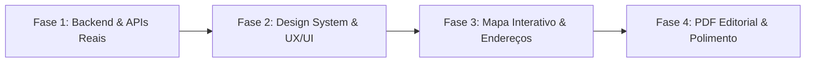

# Relatório de Viabilidade e Redesign UX/UI: Windrose App 2.0

Este relatório analisa a nova fase do **Windrose App**, cobrindo o redesenho visual inspirado nas referências do Dribbble, a resolução do problema de locais genéricos com dados reais (endereços, mapas) e o alinhamento estético de todos os componentes e exportações (PDF/ICS).

---

## 1. Análise Visual & Inspirações do Dribbble

Analisamos os conceitos selecionados:
- **Traw Travel Landing** & **Travel Companion Dashboard**: Estilo editorial de viagens contemporâneo, tipografia serifada ou sans-serif geométrica moderna (tipo *Plus Jakarta Sans* ou *Playfair Display / Inter*), uso inteligente de micro-badges com blur (*glassmorphism* refinado), cartões fotográficos imersivos com cantos generosos (`rounded-3xl` / `24px`), paleta inspirada na natureza (terracota quente, areia, verde sálvia ou marinho profundo).
- **Explore the World Travel App UI**: Foco em experiência tátil (mobile-first / app nativo), bottom navigation fluida, gestos de swipe com feedback tátil visual, status chips dinâmicos (clima atual, melhor horário para visita, nota de viabilidade).

### Identidade Visual Proposta (Design System "Windrose Wanderlust")
1. **Paleta de Cores**:
   - **Primary (Compass Amber / Terracotta)**: `#F97316` / `#EA580C` — calor, aventura e descoberta.
   - **Secondary (Ocean Depth)**: `#0F172A` / `#1E293B` — sofisticação e contraste.
   - **Accent (Sunlit Sand & Mint)**: `#FEF3C7` (highlight suave) e `#10B981` (viabilidade alta).
   - **Superfícies**: Fundo sutilmente aquecido (`#FAFAF9` no light mode / `#0B0F17` no dark), cards com bordas ultrafinas (`border-slate-200/80`) e sombras suaves multicamadas (`shadow-[0_8px_30px_rgb(0,0,0,0.06)]`).
2. **Tipografia**:
   - Títulos e Destaques: *Outfit* ou *Plus Jakarta Sans* (moderna, arejada e convidativa).
   - Corpo e Dados Meteorológicos: *Inter* (alta legibilidade, numerais tabulares).
3. **Componentes Nativos & Sensação de App**:
   - Header com blur dinâmico (`backdrop-blur-md bg-white/80`).
   - Cards de Swipe com aspect ratio cinematográfico (3:4 ou 4:5), gradiente inferior escuro suave para leitura do texto sem poluição, badges de clima flutuantes e botões de ação circulares táteis (X vermelho suave, Coração esmeralda vibrante).
   - Barra de navegação inferior flutuante para mobile / barra superior refinada para desktop.

---

## 2. Diagnóstico e Solução para o "Filtro de Locais Genéricos"

### O que acontece hoje:
Quando uma cidade não está na lista curada (`florianopolis`, etc.), o `PlacesService` recorre ao `OverpassClient`. Como a query da Overpass na API pública da Alemanha (`overpass-api.de`) frequentemente sofre timeout (4.5s) ou não encontra nós com todas as tags simultâneas no raio solicitado, o backend cai no gerador genérico `generateGenericCityPois(city, lat, lon)`, criando nomes sintetizados como *"Parque Municipal e Mirante de [Cidade]"*.

### A Solução Técnica Robusta e 100% Gratuita:

Propomos uma arquitetura em **duas camadas com enriquecimento real**:

1. **Camada 1: Overpass API Otimizada com Queries Separadas e Bounding Box**:
   - Otimizar a query Overpass para consultar `node` e `way` com tags `name` e `tourism` / `amenity` / `historic` em formato ultra-enxuto com timeout adequado.
   - Extrair os dados de endereço que o OSM já possui nas tags:
     - `addr:street`, `addr:housenumber`, `addr:suburb`, `addr:city`.
2. **Camada 2: Fallback Inteligente via Wikidata SPARQL API (100% Gratuita e Sem Rate Limit Agressivo)**:
   - A Wikidata possui o endpoint `https://query.wikidata.org/sparql` que busca monumentos, museus, praias e atrações turísticas por raio geográfico (`wikibase:around`) instantaneamente.
   - A Wikidata já devolve o **nome real oficial**, coordenadas exatas, foto em alta resolução da Wikimedia Commons e descrição enciclopédica!
3. **Camada 3: Geocodificação Reversa Nominatim OSM (para locais sem endereço)**:
   - Quando um local não tiver endereço preenchido, faremos a resolução reversa com cache na borda para gerar o endereço formatado: *"Rua / Avenida, Bairro, Cidade"*.

---

## 3. Visualização de Mapa Interativo (OpenStreetMap + Leaflet)

Adicionaremos ao **ItineraryView** e ao modal de detalhes do local um **Mapa Interativo**:
- **Stack**: `leaflet` + `react-leaflet` v5 (100% compatível com React 19) ou renderização de mapa estático SVG / MapLibre.
- **Tiles**: OpenStreetMap Standard ou CartoDB Positron (tiles minimalistas e elegantes que combinam com o design Dribbble).
- **Features do Mapa**:
  - Marcadores customizados para cada categoria (Praia = azul, Museu = roxo, Restaurante = âmbar).
  - Traçado da rota sugerida do dia interligando os pontos da manhã, tarde e noite.
  - Pin interativo com preview do card ao clicar.

---

## 4. Redesign do Relatório em PDF (Print-Friendly & Editorial)

O relatório exportado em PDF herdará o novo Design System:
- Layout de revista de viagem (*editorial travel guide*).
- Capa com o nome do destino, datas da viagem, resumo das condições climáticas e nota média.
- Timeline limpa por dia (Manhã, Tarde, Noite) com foto miniatura do local, endereço completo, categoria e recomendação do clima para o período.
- QR Code opcional para abrir o roteiro no Google Maps / celular.

---

## 5. Fases de Execução Propostas

1. **Fase 1**: Refatorar `PlacesService` no `apps/edge-api` com Wikidata SPARQL + Overpass enriquecido, garantindo nomes, fotos e endereços reais para qualquer cidade do mundo.
2. **Fase 2**: Implementar o novo Design System ("Windrose Wanderlust") no `apps/web`: redesign da Landing/Header, SwipeDeck com visual cinematográfico e feedback tátil.
3. **Fase 3**: Integrar Mapa Interativo nos Matches e Roteiro (`react-leaflet` / OpenStreetMap) com endereços formatados e links diretos para navegação.
4. **Fase 4**: Redesenhar a visualização do Roteiro e a exportação em PDF editorial, alinhando com a nova identidade visual.
