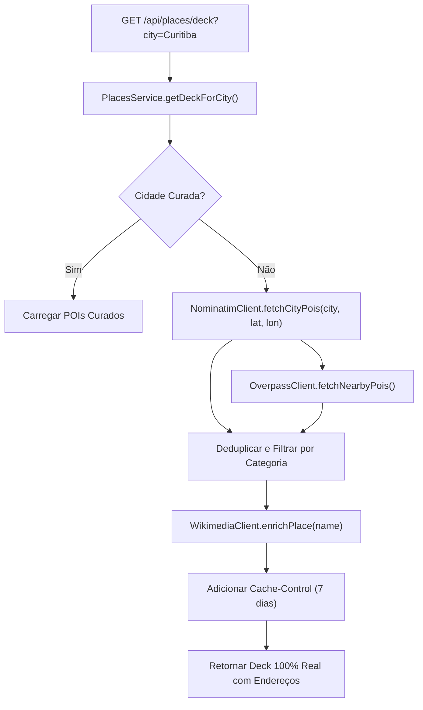

# Spec - Issue #22: Enriquecimento de POIs com Dados Reais e Endereços (Backend)

## 1. Visão Geral
Esta spec define a evolução do subsistema de pontos de interesse (`apps/edge-api`) para resolver em definitivo o problema de locais com nomes genéricos ou sintetizados para cidades não cadastradas na curadoria estática.

Integramos duas fontes reais georreferenciadas:
1. **OSM Nominatim Structured Search**: Consulta atrações turísticas (`tourism=attraction|museum`), parques e gastronomia com retorno instantâneo (< 800ms) contendo `display_name`, coordenadas reais e endereço completo estruturado (`address.road`, `address.suburb`, `address.city`).
2. **OpenStreetMap Overpass Otimizado**: Mantido com timeout de 3s para nós densos e enriquecimento de amenities locais.
3. **Wikimedia Commons Image & Description Enrichment**: Resolução de fotos reais de alta resolução para os monumentos e locais retornados.

---

## 2. Modelagem de Dados (@windrose/shared-types)
Extensão da interface `PointOfInterest`:
- `address`: string opcional com formato `"Rua / Logradouro, Bairro, Cidade"`
- `rating`: número opcional (ex: 4.5)
- `osmId`: identificador de rastreabilidade único

---

## 3. Arquitetura da Solução

---

## 4. Plano de Implementação
1. **Shared Types**: Adicionar tipagens de endereço refinadas.
2. **NominatimClient**: Novo cliente em `apps/edge-api/src/infrastructure/places/nominatim.client.ts` com User-Agent e formatação de endereço brasileiro/internacional.
3. **PlacesService Refatorado**:
   - Tentar Curadoria -> se não houver ou precisar de mais pontos, consultar Nominatim.
   - Enriquecer fotos com Wikimedia.
   - Nunca mais usar geradores genéricos de nomes repetidos.
4. **Testes Unitários & Integração**:
   - Mock de resposta do Nominatim.
   - Teste validando presença de endereço e coordenadas válidas.
